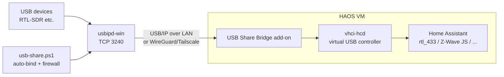

# USB Share Bridge

Share real USB devices from a **Windows 11 Hyper-V host** to a **Home
Assistant OS VM** over the network, so HAOS sees them as locally plugged-in
devices. Built for RTL-SDRs, Z-Wave/Zigbee sticks, serial adapters, and
anything else Hyper-V refuses to pass through.

This is a paired piece of software: a Windows-side manager and a HAOS
add-on, both configured from the same device list. It rides the standard
**USB/IP** protocol (kernel-backed on both ends, isochronous-capable for
SDR streaming) rather than emulating devices in userspace. The USB work on
Windows is done by [usbipd-win](https://github.com/dorssel/usbipd-win) —
the open-source, driver-signed USB/IP server; our software adds the
operational layer it lacks: config-driven sharing that survives reboots
and replugs, auto-attach on the client, reattach watchdogs, firewall
scoping, and health checks.

## Repository layout

| Path | What it is |
|---|---|
| `windows/` | Windows manager app (PowerShell, zero runtime deps): CLI, module, installer, uninstaller, tests |
| `usb_share_bridge/` | HAOS client add-on: discovery, attach, monitor/reattach loop, clean detach |
| `repository.yaml` | Makes this repo usable as a Home Assistant add-on store repository |
| `docs/research.md` | Survey of prior implementations (usbipd-win, VirtualHere, USB Network Gate, HAOS prior art) and why USB/IP is the right foundation |
| `docs/plan.md` | Architecture, tech-stack rationale, risks, testing strategy, roadmap |
| `docs/setup-hyper-v-haos.md` | Step-by-step setup for the Windows 11 + Hyper-V + HAOS scenario, including Internet use via Tailscale/WireGuard |

## Quick start

On the **Windows host**:

1. On GitHub: **Code → Download ZIP**, then extract the archive.
2. Double-click **Setup.cmd** in the extracted folder and approve the UAC
   prompt.

That's the whole install. Setup.cmd is a batch file, so the execution
policy never blocks it: it self-elevates, clears the "downloaded from the
internet" marker Windows put on the extracted files, installs usbipd-win
via winget, installs the app to `C:\Program Files\USBShare`, registers the
auto-share task, creates the Start Menu shortcut, and then opens the GUI.
The downloaded folder can be deleted afterwards.

When the GUI opens: tick the USB devices you want to share, enter the
HAOS VM's IP under "Allowed client IP(s)", and click **Save & Apply**.
Tick **Start with Windows** to have the GUI open at each logon without a
UAC prompt. Prefer a terminal? The same operations are available as
commands (`usb-share.ps1 list/sync/doctor/firewall`), and headless setup
works via `powershell -ExecutionPolicy Bypass -File windows\Install.ps1`.

On the **HAOS VM**: push this repo to GitHub, add it as an add-on repository
in Home Assistant (Settings → Add-ons → Add-on Store → ⋮ → Repositories),
install **USB Share Bridge**, set `server` to the Windows host IP and the
same device IDs (use the VID:PID values shown in the GUI), then start it.
Devices appear in Settings → System → Hardware and work like local USB
devices.

Full instructions, Internet/tunnel setup, and troubleshooting:
[docs/setup-hyper-v-haos.md](docs/setup-hyper-v-haos.md).

## Security

USB/IP has no built-in authentication or encryption. This project
mitigates that in two ways: the installer creates a Windows Firewall rule
scoped to your allowed client IPs, and for anything off the local LAN the
setup guide walks you through Tailscale or WireGuard so the stream rides an
encrypted private tunnel. Do not expose TCP 3240 to the Internet.

## Verification status

- Windows logic: 18 automated checks (list parsing, VID:PID resolution,
  dry-run plans, bind execution, config validation) pass against a fake
  `usbipd` binary — `powershell -File windows\tests\Test-UsbShare.ps1`.
- HAOS add-on: image builds against the official Home Assistant base; all
  scripts pass `bash -n`; config validation, VID:PID → bus-id discovery,
  and manifest generation pass end to end in the real container against a
  fake `usbip` server — `usb_share_bridge/tests/container-test.sh`.
- Real attach/detach requires both machines and hardware; see the
  acceptance checklist at the end of the setup guide.

## License

MIT — see [LICENSE](LICENSE). The underlying USB/IP engine on Windows,
usbipd-win, is GPL; this project wraps its CLI and installs it, it does
not modify or distribute it.
