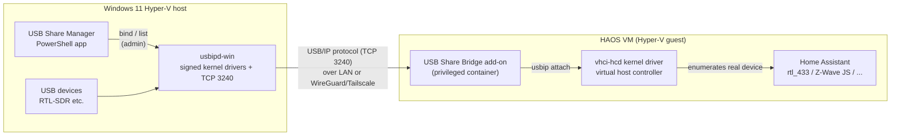

# Plan and tech stack

## Goal

A paired piece of software, installed on the Windows 11 Hyper-V host and
inside the Home Assistant OS VM, that shares chosen USB devices (Realtek
SDR, Z-wave sticks, serial adapters, …) from Windows to HAOS over the
network such that HAOS enumerates them as real local USB devices.

## Non-goal (deliberate)

We do not write a new USB-over-IP wire protocol, Windows kernel driver, or
Linux virtual host controller. Making an OS see a *real* USB device requires
kernel drivers on both ends; the standard USB/IP protocol already provides
them, with signed Windows drivers via `usbipd-win` and in-tree HAOS support
via `vhci-hcd`. Reinventing that layer would produce a worse, unsigned
result. Our software is the operational layer the raw tools lack:
config-driven sharing, auto-attach, watchdog/reattach, firewall scoping,
and a guided install on both machines.

## Architecture

Both sides are configured from one device list keyed by `VID:PID`, which
survives replugging into a different physical port (bus IDs do not).

## Tech stack and rationale

| Layer | Choice | Rationale | Alternatives considered |
|---|---|---|---|
| Wire protocol | Standard USB/IP (TCP 3240) | Kernel-backed on both ends; isochronous support for SDR streaming; any USB/IP client interoperates | Custom protocol (rejected: requires kernel drivers + signing on both ends); application-level streams like `rtl_tcp` (rejected for generic use: not device-transparent) |
| Windows server engine | `usbipd-win` (GPL, signed) | Only maintained Windows USB/IP server with properly signed drivers; avoids test-signing mode on Windows 11 | `usbip-win` forks (unsigned); VirtualHere / USB Network Gate (closed, licensed) |
| Windows management app | PowerShell 5.1-compatible module + CLI | Zero runtime dependencies on the target machine; admin context and scheduled tasks are native; USB work stays in the signed driver, so the glue layer can be simple and auditable | Go/C# service (nicer long-term, but adds a toolchain and build artifacts without changing capability today — documented as the upgrade path) |
| HAOS client app | Home Assistant add-on: Alpine HA base image + `linux-tools-usbip` + bash | HAOS is appliance-style: add-ons are the sanctioned install path; the container runs privileged with `vhci-hcd` loaded via `kernel_modules:` (proven by prior art) | Python inside the add-on (fine, but heavier than needed for shell-orchestrated attach/monitor) |
| Internet transport | WireGuard or Tailscale | USB/IP has no auth/encryption; a private encrypted tunnel plus a firewall rule scoped to the tunnel IPs is the safe Internet story | Plain TCP exposure (rejected); SSH tunnels (fragile for always-on use) |

## Components built

1. `windows/` — USB Share Manager:
   - `UsbShare.psm1` — config loading/validation, `usbipd list` parsing,
     VID:PID and bus-ID device matching, idempotent bind sync, firewall rule
     management scoped to allowed client IPs, status/doctor checks.
   - `usb-share.ps1` — CLI: `list [--json]`, `sync [--dry-run]`, `status`,
     `watch`, `firewall`, `doctor`.
   - `Install.ps1` / `Uninstall.ps1` — admin-aware installer: verifies or
     installs `usbipd-win` (winget/MSI), copies the app, registers a
     SYSTEM scheduled task that syncs at boot and every 5 minutes, scopes
     the firewall.
   - `tests/Test-UsbShare.ps1` + fake `usbipd` — runs against a stub binary
     so parsing/sync logic is verified without hardware.
2. `usb_share_bridge/` — HAOS add-on:
   - loads/verifies `vhci-hcd`, discovers shared devices from the server,
     resolves VID:PID to bus IDs, attaches with retries, monitors and
     re-attaches on loss, re-resolves after replugs, detaches cleanly on
     shutdown.
3. `repository.yaml` at repo root — the repo doubles as an HAOS add-on
   store repository; push it to GitHub and add that URL in HAOS.

## Key design decisions

- **VID:PID as the stable key.** Windows bus IDs (`1-3`) change when a
  device is replugged; VID:PID does not. Both sides resolve it to the
  current bus ID at operation time.
- **Idempotent sync, not one-shot setup.** The Windows scheduled task and
  the add-on monitor loop converge state instead of assuming the first run
  sticks. Replugs, reboots, and flaky Wi-Fi recover without intervention.
- **Best-effort detach on shutdown** on the client, so the server does not
  hold a stale attachment that blocks re-attach.
- **Fail visible, not silent.** Every stage logs; the add-on never exits
  on a transient error — it retries on the next poll — but hard
  misconfiguration (missing server address, unparseable device IDs) is
  reported immediately.

## Risks and mitigations

| Risk | Mitigation |
|---|---|
| `usbipd-win` requires admin to bind devices | Installer elevates; scheduled task runs as SYSTEM |
| HAOS kernel must include `vhci-hcd` and Supervisor must support `kernel_modules:` | Documented requirement: current HAOS; the add-on verifies the module and fails loudly with a clear message |
| USB/IP is unauthenticated | Firewall rule scoped to allowed client IPs; WireGuard/Tailscale required for Internet use |
| SDR isochronous stream drops over Wi-Fi/Internet | Wired LAN recommended; `rtl_tcp` fallback documented for SDR-only use |
| Client crash leaves server "Attached" | Add-on `finish` script detaches; attach retries include a best-effort pre-detach |

## Testing strategy

- Windows: unit-style script tests against a fake `usbipd` binary covering
  list parsing, VID:PID resolution, dry-run plans, and bind execution.
- HAOS add-on: `docker build` the image; syntax-check every script in the
  image; run the discovery script against a fake `usbip` client and a stub
  config to verify manifest generation end to end in the real container
  filesystem.
- Full attach/detach requires both machines and real hardware; the setup
  guide includes a short on-target acceptance checklist.

## Roadmap (post-1.0)

- Replace the PowerShell watchdog with a Go Windows service (single .exe,
  richer status endpoint) — no behavior change to the wire protocol.
- Add-on: optional HA notifications on device loss/reattach.
- mDNS-style server discovery to auto-fill the add-on config.
